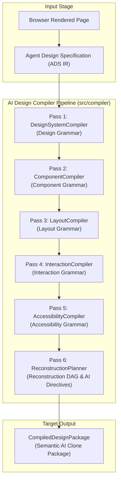

# AI Design Compiler Architecture Specification

## 1. Executive Summary & Paradigm Shift

The architecture transitions the system from an **"AI Website Extractor"** into an **AI Design Compiler**.

### 1.1 The Legacy Paradigm: Website Extractor
The previous paradigm operated as an extraction dump:
```text
Website  -->  DOM Extraction  -->  Large JSON Export (Raw styles, duplicated nodes, deep trees)
```
*Shortcomings*: Bloated JSON payload containing verbose computed CSS strings, redundant DOM nodes, deep bounding box coordinate cascades, and fragmented style trees that exhaust LLM context windows and force external coding models to guess architectural intent.

### 1.2 The Target Paradigm: AI Design Compiler
The compiler treats the browser's rendered document as source code and converts raw implementation details into **compact semantic design knowledge**:
```text
Website
   │
   ▼
Browser Extraction
   │
   ▼
Semantic Analysis
   │
   ▼
Design Grammar (Pass 1)
   │
   ▼
Component Grammar (Pass 2)
   │
   ▼
Layout Grammar (Pass 3)
   │
   ▼
Interaction Grammar (Pass 4)
   │
   ▼
Accessibility Grammar (Pass 5)
   │
   ▼
Reconstruction Planner (Pass 6)
   │
   ▼
AI Clone Package (Compiled Target)
```

> **Primary Objective:** The goal is **NOT** to reduce or throw away information. The objective is to convert raw implementation details into **compact semantic knowledge** that an AI coding model can reconstruct with identical visual fidelity.

---

## 2. Strict Architectural Invariants

The compiler subsystem (`src/compiler/`) is governed by three non-negotiable architectural invariants:

1. **Strict Decoupling from DOM:**  
   The compiler receives the authoritative **`AgentDesignSpecification` (ADS)** Intermediate Representation (IR). It **NEVER** accesses `window`, `document`, or `HTMLElement` directly.
2. **Semantic Objects Only:**  
   The compiler output contains **ZERO duplicated DOM trees**, **ZERO raw CSS stylesheets**, and **ZERO duplicated layout coordinate trees**. Every emitted artifact is a declarative semantic contract.
3. **Deterministic & Modular Passes:**  
   Each compiler pass is an isolated, testable transformation unit implementing `CompilerPass<TInput, TOutput>` orchestrated sequentially through a shared `CompilerContext`.

---

## 3. Pipeline Architecture & Data Flow



### ASCII Data Flow Architecture
```text
┌────────────────────────────────────────────────────────────────────────┐
│                   AgentDesignSpecification (ADS IR)                    │
│   • globalSystem   • colors         • typography    • spacing          │
│   • sections       • components     • layout        • interactions     │
│   • productCard    • surfaces       • constraints   • confidence       │
└───────────────────────────────────┬────────────────────────────────────┘
                                    │
                                    ▼
┌────────────────────────────────────────────────────────────────────────┐
│ PASS 1: DesignSystemCompiler                                           │
│ In:  ADS Colors, Typography, Spacing, Shapes & Surfaces                │
│ Out: SemanticDesignGrammar                                             │
│      • colorPalette (primary, surface, text, border, accent)           │
│      • typographyScale (display -> caption with hierarchy ranks)       │
│      • spacingScale (micro -> section-padding steps)                   │
│      • surfaceElevation (levels 0..3 with semantic intent)             │
└───────────────────────────────────┬────────────────────────────────────┘
                                    │
                                    ▼
┌────────────────────────────────────────────────────────────────────────┐
│ PASS 2: ComponentCompiler                                              │
│ In:  ADS Components, Variants, Canonical Product Card Spec             │
│ Out: SemanticComponentGrammar                                          │
│      • registry (Props, Slots, Variants, Composition, Token Bindings)  │
│      • canonicalProductCard (title, price, media, rating, cta badges)  │
└───────────────────────────────────┬────────────────────────────────────┘
                                    │
                                    ▼
┌────────────────────────────────────────────────────────────────────────┐
│ PASS 3: LayoutCompiler                                                 │
│ In:  ADS Sections, Layout References, Viewport Metadata                │
│ Out: SemanticLayoutGrammar                                             │
│      • viewport dimensions (standardized)                              │
│      • containers (flow pattern, alignment, responsive rules)          │
│      • flow ordering & contained component IDs                         │
└───────────────────────────────────┬────────────────────────────────────┘
                                    │
                                    ▼
┌────────────────────────────────────────────────────────────────────────┐
│ PASS 4: InteractionCompiler                                            │
│ In:  ADS Interactions, Responsive Breakpoints, Interactive Controls    │
│ Out: SemanticInteractionGrammar                                        │
│      • state transitions (idle -> active / hovered / expanded)        │
│      • effects (elevation-shift, modal-open, disclosure, color-shift)  │
│      • motion intent (timing category, durationMs, easing curve)       │
└───────────────────────────────────┬────────────────────────────────────┘
                                    │
                                    ▼
┌────────────────────────────────────────────────────────────────────────┐
│ PASS 5: AccessibilityCompiler                                          │
│ In:  ADS Structural Sections, Interactive Elements, Contrast Checks    │
│ Out: SemanticAccessibilityGrammar                                      │
│      • WAI-ARIA landmarks (banner, main, navigation, contentinfo)      │
│      • keyboard navigation sequence & focus traps                      │
│      • WCAG compliance attestation (AA / AAA)                          │
└───────────────────────────────────┬────────────────────────────────────┘
                                    │
                                    ▼
┌────────────────────────────────────────────────────────────────────────┐
│ PASS 6: ReconstructionPlanner                                          │
│ In:  All upstream grammars (Passes 1–5)                                │
│ Out: ReconstructionPlan                                                │
│      • Dependency DAG (step-1-tokens -> primitives -> composites ->    │
│        scaffold -> interactions -> verification)                       │
│      • Explicit AI Directives for LLM code generation models           │
└───────────────────────────────────┬────────────────────────────────────┘
                                    │
                                    ▼
┌────────────────────────────────────────────────────────────────────────┐
│                     CompiledDesignPackage                              │
│  The compact, authoritative semantic bundle for AI coding models       │
└────────────────────────────────────────────────────────────────────────┘
```

---

## 4. Compiler Responsibilities by Pass

### Pass 1: `DesignSystemCompiler`
- **Purpose**: Compile design tokens into functional design system semantics.
- **Transformations**:
  - Raw color frequency distributions $\to$ Semantic roles (`primary`, `surface`, `text-primary`, `text-secondary`, `text-muted`, `border`, `accent`).
  - Font sizes & line heights $\to$ Harmonic typography scale (`display`, `h1`..`h4`, `body-lead`, `body`, `caption`) with clean line-height ratios.
  - Pixel measurements $\to$ Harmonic spacing scale steps with semantic usage categories (`micro`, `inline-gap`, `component-padding`, `layout-gap`, `section-padding`).
  - Border radii and shadows $\to$ Discrete elevation levels (0: flat, 1: subtle-raised, 2: floating, 3: overlay).
- **Invariant**: Strips all raw CSS syntax and vendor prefixes.

### Pass 2: `ComponentCompiler`
- **Purpose**: Transform element clusters into declarative component interfaces.
- **Transformations**:
  - DOM clusters $\to$ Semantic component definitions (`category`, `role`, `props`, `slots`, `variants`).
  - Raw styles $\to$ Design token bindings linking components to Pass 1 tokens.
  - Ecommerce / Product Card clusters $\to$ Canonical product card contracts (`media`, `title`, `price`, `badge`, `rating`, `cta`).
- **Invariant**: Emits zero CSS class names, zero DOM element references, and zero raw HTML markup.

### Pass 3: `LayoutCompiler`
- **Purpose**: Compile spatial geometry into responsive container flows.
- **Transformations**:
  - Absolute/relative bounding boxes $\to$ High-level container topologies (`flex-row`, `flex-column`, `grid-responsive`, `stacked`, `sticky`).
  - Viewport variations $\to$ Responsive breakpoint contracts (desktop, tablet, mobile column allocations).
  - DOM hierarchy $\to$ Flow-ordered container sequence referencing component IDs.
- **Invariant**: Emits zero pixel coordinates ($x, y, w, h$) or mirrored DOM layout trees.

### Pass 4: `InteractionCompiler`
- **Purpose**: Compile interactive behavior and motion into state machine contracts.
- **Transformations**:
  - Event listeners & pseudo-classes $\to$ Trigger $\to$ State Transition $\to$ Semantic Effect.
  - CSS animations & transitions $\to$ Motion intent declarations (`timingCategory`, `durationMs`, `easing`).
- **Invariant**: No event listener bindings or raw keyframe CSS strings.

### Pass 5: `AccessibilityCompiler`
- **Purpose**: Guarantee accessible HTML5 / ARIA foundation for AI reconstruction.
- **Transformations**:
  - Sections $\to$ WAI-ARIA Landmark roles (`banner`, `main`, `navigation`, `contentinfo`, `complementary`).
  - Interactive components $\to$ Keyboard tab order sequences and modal focus trap boundaries.
  - Color contrast evidence $\to$ WCAG compliance evaluation.
- **Invariant**: Emits pure semantic contracts for screen readers and keyboard navigation.

### Pass 6: `ReconstructionPlanner`
- **Purpose**: Generate the deterministic blueprint and dependency graph for AI code generation.
- **Transformations**:
  - Synthesizes all grammars into a 6-phase reconstruction DAG (`design-tokens` $\to$ `primitives` $\to$ `composite-components` $\to$ `layout-scaffold` $\to$ `interactions` $\to$ `verification`).
  - Generates clear, unambiguous **AI Directives** tailored for LLM code generation engines.
- **Invariant**: Guarantees topological sort validity and zero circular dependencies.

---

## 5. Future Compiler Passes (Roadmap)

The compiler architecture is modular and extensible. Future passes will attach seamlessly downstream or in-line:

| Pass Number | Pass Identifier | Planned Responsibility |
|:---|:---|:---|
| **Pass 7** | `FrameworkEmitterCompiler` | Compiles grammars into framework-native component skeletons (React, Next.js, Vue 3, Svelte 5). |
| **Pass 8** | `StyleSystemAdapter` | Translates design grammar and component bindings into modern styling targets (Tailwind CSS v4 tokens, CSS Modules, or Vanilla CSS variables). |
| **Pass 9** | `TokenBudgetOptimizer` | Dynamically optimizes prompt token density based on targeted LLM context windows (e.g. 8k compact vs. 32k comprehensive context). |
| **Pass 10** | `StateMachineSynthesizer` | Compiles complex interaction graphs into XState v5 state machine definitions. |
| **Pass 11** | `VisualDiffValidator` | Validates AI-generated code output against initial compiler grammars via AST comparison. |

---

## 6. Compatibility & Coexistence Notes

1. **Zero Runtime Disruption:**  
   The introduction of `src/compiler/` does not change the behavior of existing features. All 475 vitest tests remain passing.
2. **Additional Optimized Export Path:**  
   The compiler is integrated into `ArtifactExporter` via the dedicated `'compiled-design'` and `'design-compiler'` format targets.
3. **Coexistence with Legacy Formats:**  
   Legacy formats (`all`, `ai-clone-package`, `json`, `tokens`, `ads-json`, `tailwind`, etc.) remain fully functional and supported for backwards compatibility.
4. **Clean Import Boundaries:**  
   `src/compiler/` only imports schemas and types from `src/agent-spec/` and `src/types/`. It has zero dependencies on browser runtime scripts or content scripts.
